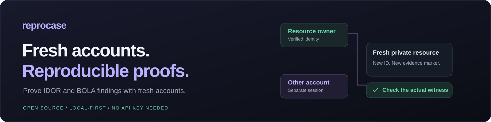
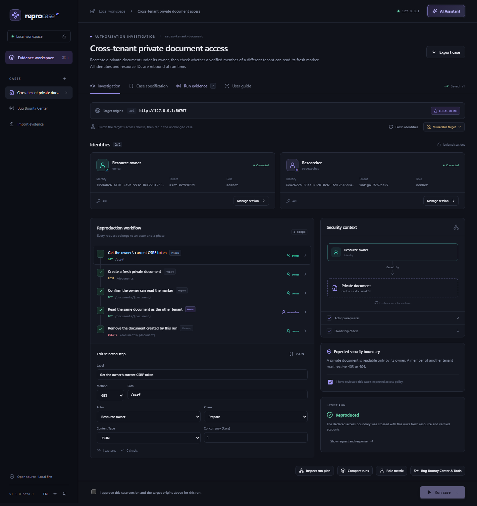
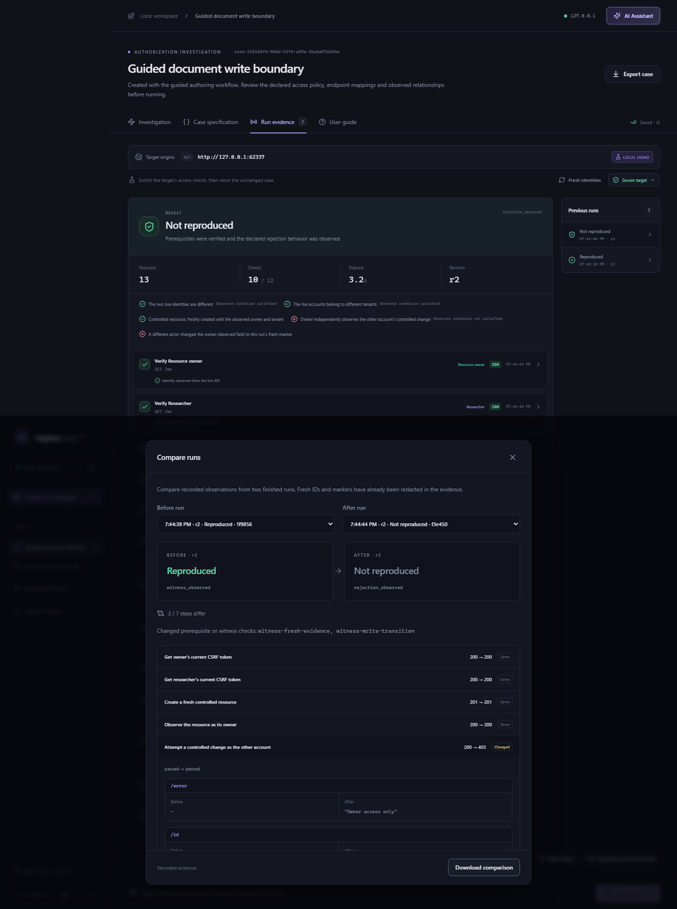

# ReproCase

<strong>An open-source AI workbench for bug bounty research and reproducible authorization testing.</strong>

  
  
  
  

  <a href="https://github.com/theasbug/reprocase/releases/tag/v1.1.0-beta.1"><strong>Download for Windows</strong></a> ·
  <a href="#try-it-in-two-minutes">Try the demo</a> ·
  <a href="docs/USER-GUIDE.en.md">User guide</a> ·
  <a href="docs/QUICKSTART.tr.md">Türkçe</a>

A finding should survive a change of accounts. ReproCase turns an authorization test into a case that another researcher can run with **their own sessions and newly created resources**. It checks who the accounts are, who owns the resource, and whether the declared security boundary was actually crossed.

Alongside the proof engine, an AI assistant can work with local files, run terminal commands, control Windows applications and connect to MCP tools. Bring your own model provider; **the local demo and deterministic case runner need no AI subscription or API key**.

> **Public beta:** Windows x64 is the packaged desktop platform. The current focus is HTTP/JSON authorization cases such as IDOR/BOLA and cross-tenant access. See [tested behavior and limitations](docs/VERIFICATION.md).

## Why ReproCase?

HTTP captures often depend on yesterday's cookies, object IDs and account setup. A successful HTTP response alone does not establish an authorization failure.

- **Verify the actors:** live identity, role and tenant checks distinguish a wrong account from a failed reproduction.
- **Create fresh evidence:** prepare a controlled resource, capture new IDs and CSRF values, then bind them to specific request locations.
- **Check a real witness:** for example, another account reads the unique marker just created by the owner.
- **Separate three outcomes:** **Reproduced**, **Not reproduced**, or **Inconclusive** when setup, sessions or evidence prevent a decision.
- **Share the scenario:** review a sanitized `.reprocase.json` package; recipients supply their own local account bindings.

The AI helps investigate and draft cases. **Explicit checks in the shared core determine the case verdict.**

*Actual application screenshot using the bundled local demo and disposable test accounts.*

## Try it in two minutes

### Windows portable

1. Download **[ReproCase-1.1.0-beta.1-Windows-x64.zip](https://github.com/theasbug/reprocase/releases/download/v1.1.0-beta.1/ReproCase-1.1.0-beta.1-Windows-x64.zip)** from Releases.
2. Extract the **entire ZIP** into a writable folder. Keep its folders together, then open `ReproCase.exe`.
3. Load the built-in local demo. Review the accounts and expected access policy, approve the case and target, inspect the preflight, then run it.
4. Choose **Fresh identities** and repeat. Switch to **Secure target** and rerun the same case to compare the result.

The portable app includes Electron and Chromium. You do not need Node.js, Python or Docker. The executable is currently **unsigned**; verify the archive against the release's SHA-256 file. Only download assets from this repository's Releases.

App data is stored in `ReproCase-data` beside the executable. Keep it private and back it up before upgrading. Extract updates into a separate folder; [desktop notes](docs/DESKTOP.md) explain data and credential portability.

### Run from source

Requires **Node.js 24.18+** and npm.

~~~sh
git clone https://github.com/theasbug/reprocase.git
cd reprocase
npm ci --ignore-scripts
npm run browsers:install
npm run demo
~~~

Open the local URL printed by the command. On Linux, first install Chromium's system dependencies with `npx playwright install-deps chromium`. Web/source use on Linux and macOS is experimental; native computer control is implemented for Windows.

For a Windows desktop source build, also run:

~~~sh
npm run desktop:setup
npm run desktop:build
npm run desktop
~~~

## Inside the workbench

### Cases and evidence

- HAR, raw HTTP, Burp XML and Postman imports become reviewable case drafts.
- Isolated Chromium account contexts, cookie or Bearer bindings, live preflight checks and explicit ownership.
- Guided editing, JSON Pointer captures, read and controlled-write cases, actor matrices and run comparisons.
- Reviewed case packages, HTML/Markdown reports and Playwright proof exports that reuse the runner inside a ReproCase checkout.
- CLI and stdio MCP entry points use the same application services as the interface.

### An AI assistant with local tools

- Chat sessions, searchable model selection by the composer and reasoning effort where supported.
- Provider presets for OpenAI, Anthropic, Gemini, DeepSeek, OpenCode Go/Zen, OpenRouter, Groq and Mistral; advanced configuration for compatible or local endpoints.
- Model discovery, streamed messages, provider-returned reasoning fields, tool activity, usage and token speed when available.
- File search/read/edit with backups, terminal execution, and native Windows screenshots, windows, mouse, keyboard, clipboard and accessibility tools.
- Follow-up messages during work, permission cards, and stdio/HTTP MCP management via `/mcp`.

Connect with **Provider + API key**, then choose a model inside **AI Assistant**. Catalog access, quotas, capabilities and reasoning visibility depend on the provider. [Provider details](docs/AI-PROVIDERS.md).

### Bug bounty utilities

Program scope and exclusions, managed-request rate limits and budgets, bounded CT/HTTP discovery, JWT/JS/traffic helpers, CVSS v3.1 and a finding tracker. English and Turkish interfaces include a searchable step-by-step guide.

External tools such as Nuclei, subfinder, httpx, ffuf, nmap and sqlmap are **detected when installed**; they are not bundled. Recon observations are investigation candidates, not confirmed vulnerabilities.

<strong>See a vulnerable → secure run comparison</strong>

## Execution and sharing

The local service binds to loopback and uses an authenticated interface. Imports do not start target requests. Case packages contain declarative steps, not arbitrary JavaScript or shell programs.

Scope, exclusions, budgets, cancellation and a shared program rate limiter apply to **ReproCase-managed scans and case requests**. Terminal commands, desktop interactions and external MCP servers are not sandboxed by that network policy. Autonomous mode is an explicit, persistent permission choice, not OS isolation. **Ctrl+Alt+Esc** cancels active agent work and managed scans; it cannot undo actions already dispatched.

Known credentials are redacted from shared evidence; review exports because unrelated confidential content can remain. Program HTTP header values stay in memory. Saved desktop provider/MCP credentials use Windows OS encryption. Never publish `ReproCase-data`, local sessions, bindings or private captures.

The `.reprocase.json` runner is the primary proof format. Playwright exports require a ReproCase checkout, approved revision and local actor credentials. Hurl exports are **request drafts without verdict assertions**. See [exports](docs/EXPORTS.md) and [security](SECURITY.md).

## Development

TypeScript · npm workspaces · Node.js · Fastify · React/Vite · Zod · SQLite · Playwright · Electron.

~~~sh
npm run typecheck
npm test
npm run desktop:build
npm run test:e2e
~~~

On Windows, `npm run test:desktop` checks the desktop application after desktop setup/build. Native input tests can move the pointer and type; use a dedicated desktop session. Package with `npm run desktop:package`; select a fresh `REPROCASE_PACKAGE_OUT` if the default output exists.

GitHub Actions checks source on Linux and Windows, then packages and smoke-tests the Windows executable. [Verification notes](docs/VERIFICATION.md) distinguish local results, historical provider experiments and current release limitations.

## Documentation and community

- [English guide](docs/USER-GUIDE.en.md) · [Türkçe kılavuz](docs/USER-GUIDE.tr.md) · [Türkçe hızlı başlangıç](docs/QUICKSTART.tr.md)
- [Case format](docs/CASE-FORMAT.md) · [CLI](docs/CLI.md) · [Proof exports](docs/EXPORTS.md)
- [Desktop](docs/DESKTOP.md) · [AI providers](docs/AI-PROVIDERS.md) · [Changelog](CHANGELOG.md)
- [Contribute](CONTRIBUTING.md) · [Report a bug](https://github.com/theasbug/reprocase/issues/new/choose) · [Security reporting](SECURITY.md) · [Release checks](docs/RELEASE-CHECKS.md)

Useful contributions include minimal local reproductions, provider compatibility reports without keys, case templates, accessibility improvements and translations. If ReproCase helps your research, a star helps others discover it.

## License and acknowledgments

[Apache-2.0](LICENSE). Third-party components retain their licenses. Built on Playwright, Electron, the MCP TypeScript SDK and the wider open-source community. [Hurl](https://hurl.dev/) is an existing HTTP testing tool and a useful comparison for request replay; the focus here is preserving account/resource relationships and validating evidence when accounts change.
